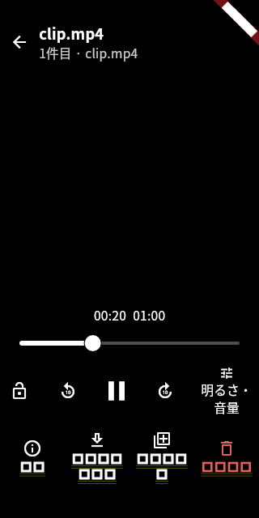
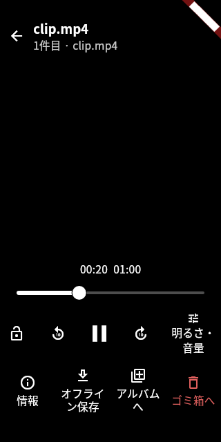
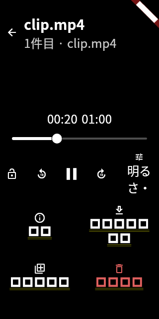
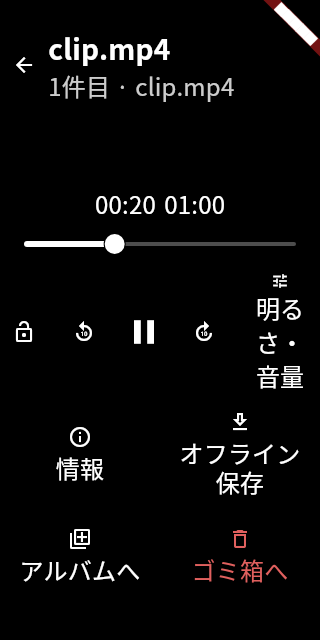
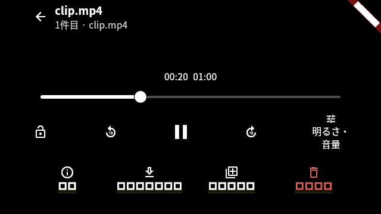
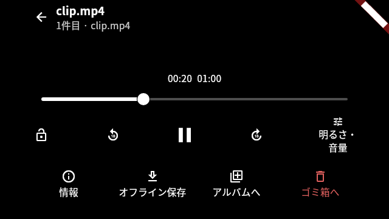

# 動画UIのクラウド検証と退行修正（2026-10-22）

`0738bee990d4ff80b24dd17bec8e75a3065c125d` に対する検証で見つかった、フッターの文字継承、
文字拡大時のラベル省略、保存動画の操作領域、検証コードの失敗・停止を修正した。
独立ブランチは `fix/video-ux-validation-20261022`。**Flutterテストは除外なしの488件が完走・PASS、Web releaseもビルド成功。**
解析は新規7件の指摘を解消した。基点から存在する6件のinfoが残るため、通常の `flutter analyze` 自体はexit 1であり、PASSと扱わない。

既存PR195には変更を加えていない。PR作成、merge、deploy、実データ操作、実機成功の主張は行わない。
背景再生・PiP・OSロック画面操作・Web保存・backup除外は引き続き未実装。

## 原因と修正の対応

| 発見した問題 | 原因・修正 |
| --- | --- |
| フッターが四角い日本語・黄色二重下線になる | `ViewerScreen` のScaffoldより外側で `DefaultTextStyle.of(context)` を取得し、MaterialAppの `monospace`・エラー用下線を描画/計測へ渡していた。本番コードで `Theme.of(context).textTheme.bodyMedium` を使い、同じJPフォント・localeで計測/描画するよう修正した。テスト側にMaterialを足して隠す修正ではない。 |
| 文字2倍で「明るさ・音量」が途中で消える | 80dpの領域に対する2行制限で残りの文字が切れていた。文字を省略せず折り返すようにし、実RenderParagraphの省略検査を追加した。 |
| gridの3テストで表示上同じexpected/actualが不一致 | recordに入れたListの比較が要素比較にならなかった。保存件数・ライブラリ・キー一覧をそれぞれ検査し、接続切替後の後続保存禁止の期待値を維持した。 |
| 縦スワイプのテストに40msのTimerが残る | テストのドラッグ座標時刻だけではDoubleTap recognizerの仮想時間が進まなかった。`kDoubleTapMinTime` を進める。Timer検査や「明るさ/音量に触らない」検査は外していない。 |
| 保存動画の手動開始/停止がテストで届かない | 初期化済みのFakeVideoは透明なsurfaceであり、子のhit-test任せのGestureDetectorではtapが届かなかった。実装の動画領域全体をopaqueな操作対象とし、テストも最後のGestureDetector任せから専用keyへ変更した。復帰待ちの手動停止を上書きしない期待値は維持した。実Textureでの不具合再現とは主張しない。 |
| screen_awakeのwidget検証が停止 | `setUp` 側の実時間で生成したFuture/streamを、widgetの仮想時間からawaitしていた。widgetと同じzoneで生成し、その中で解放・完了確認する。画面保持の製品コードを書き換えてテストを通したわけではない。18件すべて実行した。 |
| offline_privacyがI/O・目録待ちで停止 | 実ファイル読み書きを仮想時間内で直接awaitしていた。実I/Oは `tester.runAsync`、UI反映は完了条件とpumpで待ち、画面保持の完了通知も両zoneを進めて確認する。9件すべて実行した。 |

## フッターの前後画面

修正前は0738beeの本番コード、修正後はこのブランチの本番コード。
両方とも既存のHomeShell→openViewer経路を通る撮影harnessを使用し、同梱JPフォントとMaterialIconsを読み込んだ。
各条件で一覧・動画・調整・操作ロック・情報・元一覧の6段階を撮影した。変更前18枚、変更後18枚、font単独2枚の計38枚。

| 条件 | 修正前 | 修正後 |
| --- | --- | --- |
| 320×640、文字1.3倍 |  |  |
| 320×640、文字2倍 |  |  |
| 640×360、文字1.3倍、左右44/下21の安全領域 |  |  |

[修正前の回帰検査](footer-style-regression-before.txt)は3条件とも `Expected R2GalleryJP / Actual monospace` で失敗した。
修正後はラベルの実描画スタイルについてJP family・`ja_JP`・指定fallback・下線なし・不適切な900weightなしを検査し、
48dp以上の操作対象、SafeArea、再生バーと作品操作バーの境界、ラベル省略なし、戻り先・再生位置・破棄も検査してPASSした。
アイコンはwidgetテストで自動ロードされないためharnessでMaterialIconsを読み込んだ。これは製品の文字継承修正とは別の撮影準備である。

**デコーダーは既存FakeVideo。実メディア再生・first frame・性能・ブラウザ実画面の証拠ではない。**
明るさのチャネルはwidget撮影環境でMissingPluginとなるため、OS輝度/実音量の動作成功にも読み替えない。
変更前画像の四角表示はこのテスト環境でのfallbackであり、元の実機で中国語字形が出たことを再現した証拠ではない。

## 日本語字形とfallbackの検証

- [1倍の文字画面](font-after/after-japanese-1.0.png)、[2倍の文字画面](font-after/after-japanese-2.0.png): JP漢字・かな・半角かな・英数字、400/700の実Flutter描画。
- [資産検証](font-assets-final.txt): Regular/BoldのSHA-256、正規JP faceの代表漢字outline、収録範囲、JP shaping、異体字、OFLを再検証してPASS。
- フッターのRenderParagraphは `R2GalleryJP` / `ja_JP` / `fontFamilyFallback: ['sans-serif']` を使うことを検査する。計測も同じstyleを使う。
- JP資産に収録される対象文字は14,391 codepoint。範囲外の文字・絵文字等はplatform fallbackに委ねる。全Unicodeや実機/ブラウザ固有のfallback表示は未検証。

## 実行済み検証

SDKは公式manifest `https://storage.googleapis.com/flutter_infra_release/releases/releases_linux.json` から選定したFlutter 3.44.6 / Dart 3.12.2。
以前の証跡のURLには余分な `flutter/` があり、新環境では403解消後に404を返した。正規パスの取得はHTTP 200。
[SDK整合性記録](sdk-integrity.txt)のSHA-256はmanifestと一致し、SDK HEADは `ee80f08bbf97172ec030b8751ceab557177a34a6`。
実行時のanalyzer cacheは、SDKが提供する `ANALYZER_STATE_LOCATION_OVERRIDE` により書込み可能な/tmpへ置いた。
HOME・TLS・sandbox・権限を変える回避は行っていない。

| 検査 | 結果 | 証跡 |
| --- | --- | --- |
| `flutter test --no-pub --reporter expanded` + 撮影用defines | **488件 PASS、除外なし、skipなし、exit 0** | [全ログ](flutter-full.txt)、[argv・日時・exit](flutter-full.json) |
| 問題が出た5ファイルの回帰テスト | 83件 PASS | [ログ](regression-tests.txt) |
| `flutter analyze --no-pub` | info 6件、error/warning 0、exit 1。新規7件は解消 | [現在](analyze-new-lints-fixed.txt)、[基点6件](baseline-analyze.txt)、[差分照合](analyzer-delta.json) |
| `flutter build web --release --no-pub` | PASS、通常JS版。JS interopもcompile成功 | [ログ](build-web-final.txt) |
| Web生成物のloopback GET/HEAD | 6資産PASS、JPフォントはsourceと同じbytes/hash | [結果](local-web-assets.json) |
| 日本語font資産 | PASS | [ログ](font-assets-final.txt) |
| `node .github/ci/run.mjs fast` | PASS: lint・Worker型検査・tools 51件・Worker 68件・gitleaks・leak-check | [ログ](ci-fast-pinned.txt) |
| AIルール・diff整合性 | PASS | [AIルール](ai-rules-final.txt)、[diff](diff-check-final.txt) |

解析で残る6件は基点と同一: `client.dart` のnull-aware要素3件、`models.dart` の `Page_` 名、
`app_state.dart` の不要importとoverride引数名。lint設定・fatal判定を弱めず、無関係な型名変更は行わなかった。
全Flutterテストに含まれるpath_provider等のMissingPlugin診断は、widgetテストの代役範囲を示し、実機成功の証拠ではない。
Wasm dry runは既存の `get_thumbnail_video` / `dart:html` 非対応を警告する。通常JSビルドの成功とWasm対応は区別する。
fastでは既存のMiniflare互換日fallback・空Rangeのassertion診断が出るが、Worker 68件は成功した。
禁則語リストは環境にないため、その語句検査だけはskipされており成功に数えない。

Node系はpackage.json指定のpnpm 9.15.9で実行する。環境既定pnpm 11は新しいbuild承認形式で停止したため、
自動生成された作業用workspace設定を退避し、既存のCorepackと指定済み9.15.9を使用した。依存lockfile・build承認設定・秘密検査設定は変更していない。

## 残る環境制約

- Chromiumは通常sandboxのSUID helper構成エラーでabort。[観測](browser-startup.txt)。sandbox無効化・権限変更・別経路での回避をしていない。Web実画面、実動画、ブラウザWake Lockは未検証。
- Android SDK不在。[APK試行](build-apk-unavailable.txt)。APK生成、Android実機のタッチ/TalkBack・窓の明るさ・画面保持、iOS実機は未検証。
- 変更前後の実画面動画記録、cold/warmの起動性能、platform fallbackの実機比較は未取得。
- 背景再生・PiP・ロック画面・Web保存・backup除外を今回の前景UI検証で完了扱いしない。

ビルド生成物はローカルの `flutter/build/web` にあり、本番へ配布していない。
共有用のローカル成果物は `/workspace/r2-video-fix-evidence/web-release-final.tar.gz`（Gitにはbuildを追加しない）。
Git保存用のテキストログは行末空白だけを除去した。ログ・画像のhashは [SHA256SUMS](SHA256SUMS) に収録する。
